<div align="center">

<a href="https://atlas-os-sm.netlify.app">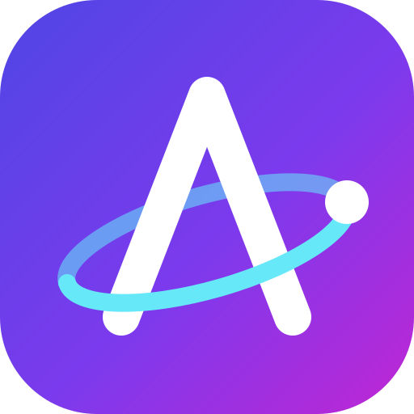</a>

# ATLAS OS

### Your AI assistant in the browser — chat, live voice, camera, plans, calendar and email, on any device, with your own key.

<a href="https://atlas-os-sm.netlify.app"></a>

<a href="https://app.netlify.com/projects/atlas-os-sm/deploys"></a>
<a href="https://github.com/SHASHWAT-MISHRA-997/Atlas-OS/actions/workflows/tests.yml"></a>


**[Live app](https://atlas-os-sm.netlify.app)** ·
[Screenshots](#-screenshots) ·
[Features](#-features) ·
[How it works](#-how-it-works) ·
[Get started](#-get-started-in-2-minutes) ·
[Privacy](#-your-data-and-keys) ·
[Develop](#-develop) ·
[Docs](#-project-docs)

</div>

> [!NOTE]
> **ATLAS OS is a web app, not an operating system, and it is not production-ready.** It is built and
> tested by one developer. Everything on this page describes what exists today (v0.29.7). Features
> marked 🧪 pass their automated tests with **FAKE** AI services but have **not yet been tried against
> the real provider**. The full, honest status of every feature is in
> [docs/FEATURE_MATRIX.md](docs/FEATURE_MATRIX.md).

---

## 📸 Screenshots

<table>
  <tr>
    <td width="66%">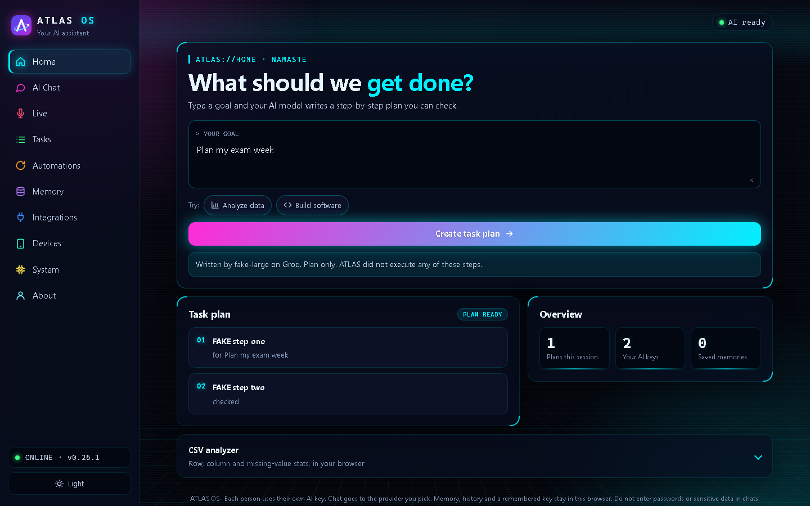</td>
    <td width="34%">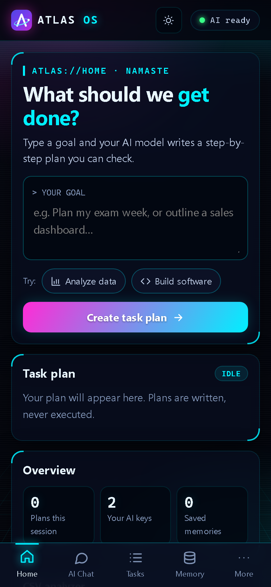</td>
  </tr>
  <tr>
    <td align="center"><b>Home</b> — type a goal, get a step-by-step plan (never executed)</td>
    <td align="center"><b>Phone</b> — the same app, with a bottom tab bar</td>
  </tr>
  <tr>
    <td>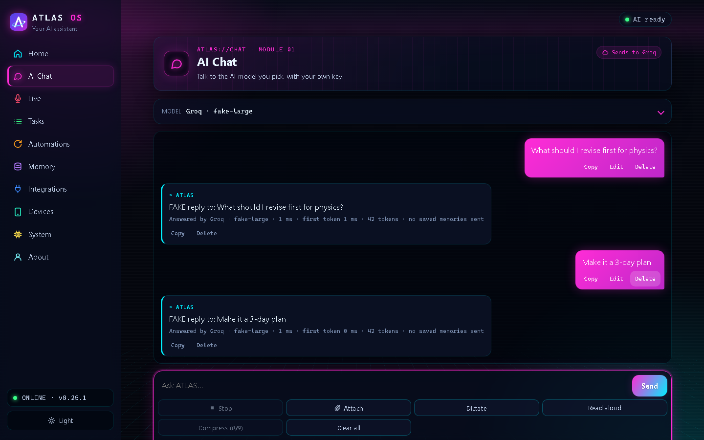</td>
    <td>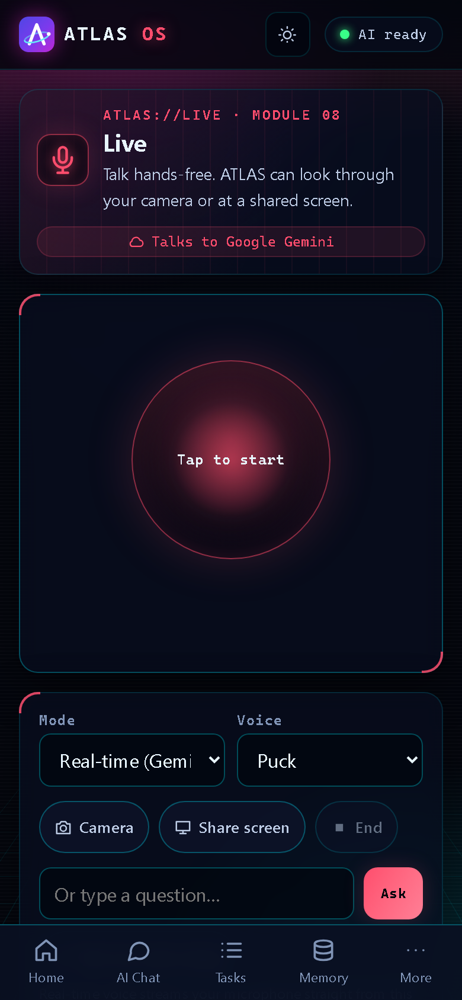</td>
  </tr>
  <tr>
    <td align="center"><b>AI Chat</b> — streaming answers, who answered, copy / edit / delete</td>
    <td align="center"><b>Live</b> — tap the orb and talk; camera and screen share</td>
  </tr>
  <tr>
    <td>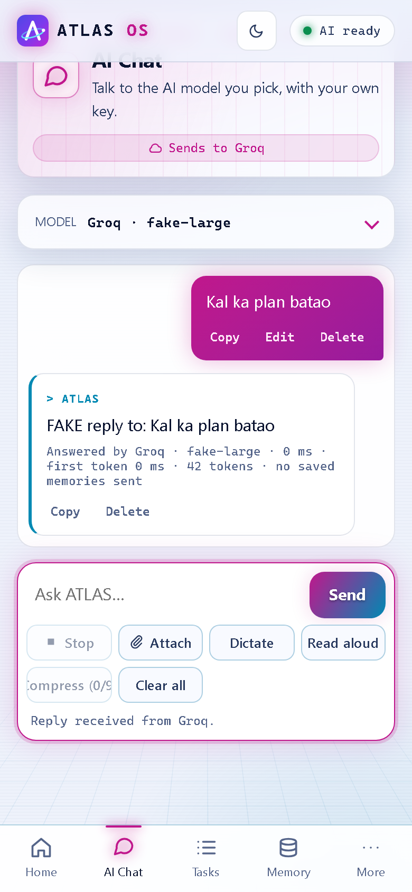</td>
    <td>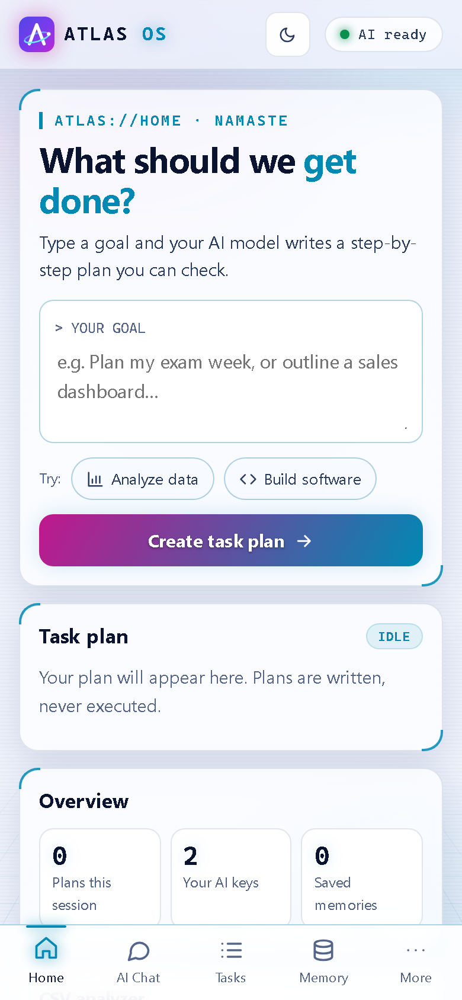</td>
  </tr>
  <tr>
    <td align="center"><b>AI Chat on a phone</b></td>
    <td align="center"><b>Light theme</b> — dark, light, or follow the device</td>
  </tr>
</table>

<sub>Screenshots are of the real app, taken by <a href="scripts/netlify/screenshots.mjs"><code>scripts/netlify/screenshots.mjs</code></a> from the local preview with the labelled <b>FAKE</b> model (its replies say "FAKE") and FAKE Google and voice services with "(demo)" data. No real key, account or personal data appears.</sub>

---

## ✨ Features

| | Feature | What you get | Status |
|:-:|---|---|:-:|
| 💬 | **AI Chat** | Streaming answers you can stop, copy, edit or delete. Thinking level (Auto / Low / Medium / High). Images and PDFs. Send a new message mid-reply to steer it. Long chats are compressed into a summary. | ✅ |
| 🔁 | **Auto-switch** | If your free provider hits its limit or is down, another free key you added answers. **Never** switches into a paid one. | ✅ |
| 🎙️ | **Live — real-time voice** | With a free Google Gemini key: streaming voice like the Gemini app, 8 voices, talk over it to interrupt, camera or shared screen. | 🧪 |
| 🗣️ | **Live — ChatGPT voice** *(paid, optional)* | OpenAI's Realtime API with your own OpenAI key — only after you tick that it is billed to you. | 🧪 |
| 🔄 | **Live — turn by turn** | Works with any provider: listen → answer → speak, with a picture from the camera when it is on. | ✅ |
| 🔊 | **Natural voice** | Answers read aloud in Gemini's natural voices with a Gemini key; otherwise the best voice your browser has. | 🧪 |
| ⌨️ | **Dictate anywhere** | Chrome, Edge and Safari use their own speech service. In **Brave and Firefox**, your Groq or Gemini key writes down what you say. | ✅ |
| 🖥️ | **PC control in Live** *(Windows)* | With the free ATLAS PC helper running on your PC and paired with a 6-digit code, Live opens apps, websites and files, searches YouTube, plays music, changes the volume, types and presses shortcuts. Typing, shortcuts and closing windows ask **Allow?** on the PC first; it never deletes, runs commands or shuts down. See [pc-helper/README.md](pc-helper/README.md). | 🧪 |
| 📞 | **Phone actions in Live** | "Call Mom", "WhatsApp Rahul: running late", "navigate to India Gate", "play Arijit on YouTube": Live fills it in as a button; **nothing happens until you tap it**, then your phone's own app opens. | 🧪 |
| 🧠 | **Memory** | Notes you save are sent with chats so answers fit you. Export as JSON. | ✅ |
| 🗺️ | **Plans and summaries** | Turn a goal into steps or summarize long text. Plans are written, never executed. | ✅ |
| ⏰ | **Automations** | Plans and reminders on a schedule, while ATLAS is open. | ✅ |
| 📊 | **CSV analyzer** | Rows, columns and missing values — the file never leaves your browser. | ⚪ |
| 📱 | **Devices** | Export your data from one device and import it on another, or erase it. Keys are left out unless you ask. | ✅ |
| 🎨 | **Themes and install** | Dark / light / auto, neon design, install to the home screen, update banner. | ✅ |

<sub>✅ passes its automated browser tests (Chromium, with a labelled FAKE model) · 🧪 passes its tests with FAKE services, not yet tried with the real provider · ⚪ built, no automated test. None of this is a guarantee for every browser or device; see <a href="docs/FEATURE_MATRIX.md">FEATURE_MATRIX</a>.</sub>

**Not supported** (ATLAS says so instead of pretending): sending email or messages, changing calendar events, controlling a phone beyond prepared one-tap actions (no reading contacts, messages or notifications), acting on a computer without the ATLAS PC helper, and local models.

---

## 🧭 How it works

One web page, one small serverless function, and **your own** AI keys. There is no ATLAS account and no database.

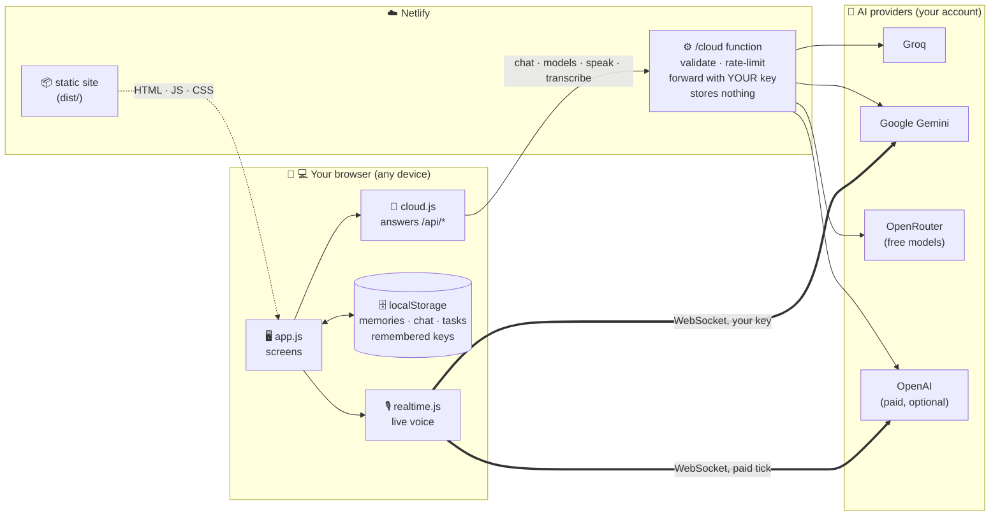

<details>
<summary><b>💬 What happens when you send a chat message</b> (click to open)</summary>

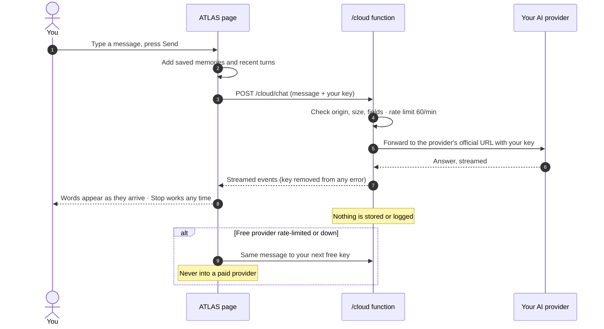

</details>

<details>
<summary><b>🎙️ How real-time voice works</b></summary>

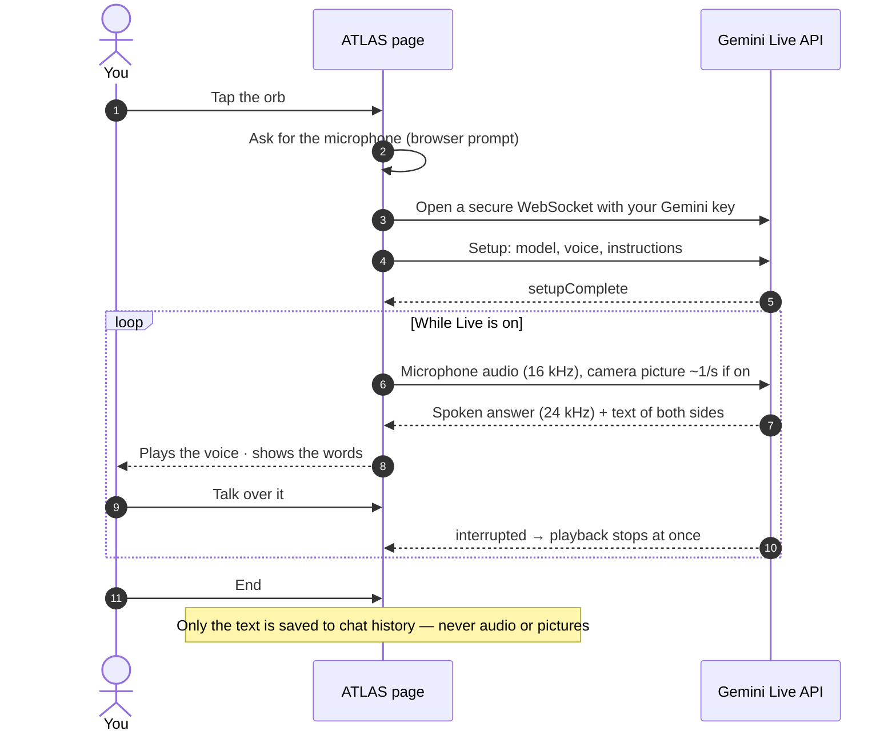

</details>

---

## 🚀 Get started in 2 minutes

1. **Open** 👉 **[atlas-os-sm.netlify.app](https://atlas-os-sm.netlify.app)** on your phone, tablet or computer. Nothing to install.
2. **Get a free key** — Home shows *Start here*. Pick a provider, tap *Open … key page*, sign in, create a key and copy it.
3. **Paste and save** in AI Chat. ATLAS checks it with the provider first; a rejected key is not saved and the provider's message is shown.
4. *(Optional)* **Install**: Android / desktop Chrome or Edge → *Install app*. iPhone / iPad → Safari → **Share → Add to Home Screen**.

| Provider | Get a key | Cost | Best for |
|---|---|---|---|
| ⚡ **Groq** | [console.groq.com/keys](https://console.groq.com/keys) | Free tier, rate limited | Fast chat · speech-to-text in Brave/Firefox |
| ✨ **Google Gemini** | [aistudio.google.com/apikey](https://aistudio.google.com/apikey) | Free tier, rate limited | Real-time voice · natural voice · images and PDFs |
| 🌐 **OpenRouter** | [openrouter.ai/settings/keys](https://openrouter.ai/settings/keys) | Only `:free` models are listed | Trying many models |
| 💳 **OpenAI** *(paid)* | [platform.openai.com/api-keys](https://platform.openai.com/api-keys) | Billed to your account | ChatGPT voice · GPT models |

<sub>Free limits and prices are set by each provider and can change. ATLAS cannot promise a provider stays free.</sub>

<details>
<summary><b>🖥️ Devices and browsers</b></summary>

| | Where | What is known |
|:-:|---|---|
| 🤖 | Android (Chrome) | Layout tested at phone sizes in Chromium. Not yet checked on a real phone. |
| 🍎 | iPhone, iPad (Safari) | iPad sizes checked in Chromium with an iPad user agent. Not run in real Safari. |
| 🪟 | Windows, Mac, Linux, ChromeOS | Chromium tests pass. Screen sharing works in desktop browsers only. |
| 🦁 | Brave, Firefox | They have no working speech service, so Dictate and Live record and your Groq/Gemini key writes it down (tested in Chromium posing as Brave). |

</details>

---

## 🔒 Your data and keys

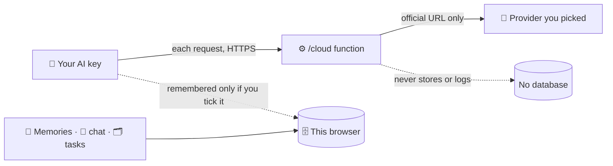

- **No ATLAS account, no database, no sync.** What you save stays in that browser on that device.
- **Your key, your bill.** The site owner's keys are never used; the function reads no environment keys at all.
- **Fixed destinations.** The function talks only to each provider's official address, so it cannot be used to send your key elsewhere. Errors that repeat your key are redacted.
- **Strict page security.** A Content-Security-Policy lists every outside host the page may talk to; all text is shown as text (never run as code).
- **Paid is opt-in.** OpenAI and ChatGPT voice are used only when you pick them; ChatGPT voice also needs a billing tick.

> [!WARNING]
> Chats go to the provider you pick, under its terms (free Gemini data may be used by Google to improve its products).
> A remembered key can be read by anyone using your unlocked device. **Do not put passwords or sensitive data in chats.**
> This project has **not** had an independent security audit — see [docs/THREAT_MODEL.md](docs/THREAT_MODEL.md).

---

## 🛠️ Develop

Needs **Node.js 20+**. No framework, no bundler for the app code.

```bash
npm ci
node scripts/netlify/build.mjs                       # writes dist/
ATLAS_FAKE_MODEL=1 node scripts/netlify/dev-server.mjs  # http://localhost:8888 with a labelled FAKE model
```

<details>
<summary><b>🧪 Tests and checks</b> — all must pass before every pull request</summary>

| Check | Command | What it covers |
|---|---|---|
| Function, attack and size tests | `node --test netlify/tests/cloud.test.mjs netlify/tests/attack.test.mjs netlify/tests/budget.test.mjs` | Provider requests, validation, key redaction, cross-site and injection attacks, CSP, first load under 80 KB gzipped |
| Browser tests | `node --test netlify/tests/e2e.test.mjs` | Real Chromium (Playwright) at phone size against the preview with FAKE providers |
| Secret scan | `detect-secrets scan --all-files --exclude-files '(^|/)(\.git\|node_modules\|dist\|tests)/'` | Must report no results |

Latest run (2026-10-28, v0.26.0): **37** function tests, **20** browser tests and **19** PC helper tests passed (Chromium; helper on Windows); CI job `cloud` runs the same on every push. Details and the list of manual checks still needed: [docs/TEST_PLAN.md](docs/TEST_PLAN.md).

To refresh the README screenshots: `node scripts/netlify/build.mjs && node scripts/netlify/screenshots.mjs`.

</details>

<details>
<summary><b>📁 Project structure</b></summary>

```text
Atlas-OS/
├── frontend/
│   ├── index.html                 page shell
│   └── static/
│       ├── app.js                 every screen
│       ├── app.css · theme.js     neon design, dark/light
│       ├── cloud.js               answers /api/* in the browser, auto-switch
│       ├── realtime.js            Gemini Live + OpenAI Realtime voice (lazy-loaded)
│       ├── live-worklet.js        microphone capture
│       └── sw.js · manifest       install + offline shell
├── netlify/
│   ├── functions/atlas.mjs        the one function (/cloud/*)
│   ├── lib/cloud.mjs              status · chat · models · speak · transcribe
│   └── tests/                     function, attack, size and browser tests
├── scripts/netlify/               build · dev server · README screenshots
├── docs/                          architecture, threat model, test plan, decisions…
└── netlify.toml                   build, rate limit, security headers
```

</details>

<details>
<summary><b>☁️ Deployment</b></summary>

The GitHub repository is linked to the Netlify project **atlas-os-sm**: every merge to `main` builds with
`node scripts/netlify/build.mjs` and deploys to **https://atlas-os-sm.netlify.app**; pull requests get a
deploy preview.

</details>

---

## 📚 Project docs

| | Doc | Read it for |
|:-:|---|---|
| 📊 | [FEATURE_MATRIX](docs/FEATURE_MATRIX.md) | The honest status and evidence for every feature |
| ☁️ | [CLOUD](docs/CLOUD.md) | Keys, providers, Google setup, how it deploys |
| 🧱 | [ARCHITECTURE](docs/ARCHITECTURE.md) | Every file and how they fit |
| 🛡️ | [THREAT_MODEL](docs/THREAT_MODEL.md) | Threats, mitigations and what risk is left |
| 🧪 | [TEST_PLAN](docs/TEST_PLAN.md) | Test suites, latest results, manual checks |
| 🧭 | [DECISIONS](docs/DECISIONS.md) | Why things are built the way they are |
| 🤝 | [HANDOFF](docs/HANDOFF.md) | Current state and next tasks |
| 📝 | [CHANGELOG](CHANGELOG.md) | What changed in each version |

<sub>Versions up to 0.14.0 also had a PC version (FastAPI backend, Windows installer, PC actions, local models). It was removed in 0.15.0 at the owner's request and is still in the Git history.</sub>

---

<div align="center">

**Built by [Shashwat Mishra](https://shashwatmishra-portfolio.netlify.app/)** — AI & Robotics Engineer

<a href="https://shashwatmishra-portfolio.netlify.app/"></a>
<a href="https://www.linkedin.com/in/sm980/"></a>
<a href="https://github.com/SHASHWAT-MISHRA-997"></a>
<a href="https://www.youtube.com/@ShashwatMishra-997"></a>

<sub>Contributions: see <a href="CONTRIBUTING.md">CONTRIBUTING</a> · Security reports: see <a href="SECURITY.md">SECURITY</a></sub>

</div>
