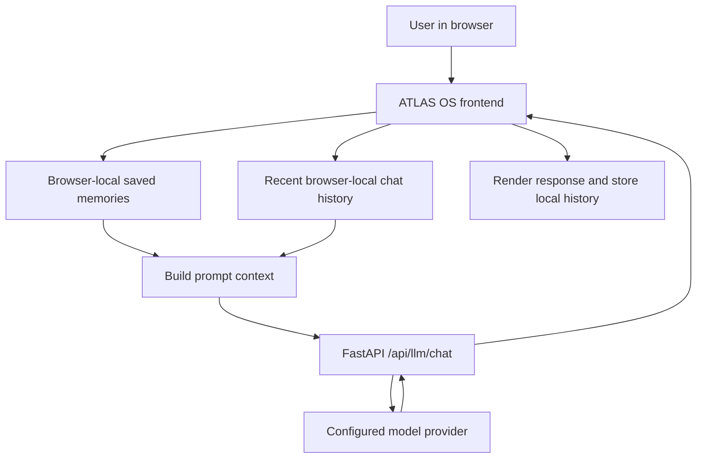

# ATLAS OS — early-stage agentic assistant starter

[](https://github.com/SHASHWAT-MISHRA-997/Atlas-OS/actions/workflows/tests.yml)

ATLAS OS is an early, shareable starter for an agentic workspace. This release contains a polished responsive frontend, a small FastAPI backend, API tests, and deployment guidance.

## Current project status

This repository is an early-stage prototype. The automated backend test suite currently passes locally in the working copy (12 tests, including mocked provider success and timeout handling). GitHub Actions will run the same backend tests after this workflow is committed to the repository; its hosted result has not yet been observed. No live provider, deployment, desktop-control, or remote-device tests are claimed.

## Important scope
This is **not yet a production-ready autonomous computer operator**. The task runner is deliberately a safe demo planner; it does not execute arbitrary shell commands, connect to external services, or deploy code. The CSV workbench is a real, client-side feature: it reads the selected CSV in the browser and generates a local report. It does not send the CSV to the backend. Those broader agent capabilities require explicit integrations, permissions, isolation, and security review.

## Included
- Responsive cyber-tech dashboard and command box
- Demo task planning UI with progress/status updates
- Working browser-local CSV analysis: row/column counts, missing cells, numeric min/mean/max, preview, and downloadable JSON report (10 MB / 100,000-row / 200-column limits)
- Browser-local memory manager: add, edit, delete individual memories, or clear all; stored in this browser profile only
- AI Chat screen connected to the FastAPI BYOK chat endpoint; includes recent browser-stored turns and saved memories in each prompt
- FastAPI `/health` and `/api/tasks/plan` endpoints
- Input validation and bounded request length
- Automated API tests
- Dockerfile and environment example

## Run locally
Requirements: Python 3.11+

```bash
cd backend
python -m venv .venv
# Windows PowerShell: .venv\\Scripts\\Activate.ps1
# macOS/Linux: source .venv/bin/activate
pip install -r requirements.txt
uvicorn app.main:app --reload
```

Open http://127.0.0.1:8000 for the frontend and http://127.0.0.1:8000/docs for API docs.

## Test
```bash
cd backend
pip install -r requirements.txt
pytest -q
```

## Deployment
A GitHub repository and hosting account must be connected by the owner. No credentials are included in this archive. Never commit API keys, tokens, `.env`, or private datasets.
- For Vercel, configure the project to serve the frontend and use a separately hosted FastAPI backend, or use a supported Python function layout.
- For Netlify, deploy the frontend as a static site and host FastAPI separately.
- Set the frontend API URL only to your trusted backend.
- Enable HTTPS, rate limiting, authentication, CORS allowlists, secrets management, and logs before public use.

## Memory feature scope
The memory manager currently stores user-entered facts/preferences in browser `localStorage`. It survives refreshes in the same browser profile, but does not sync across devices, is not encrypted by this app, and is included in prompts from the AI Chat screen when a message is sent. Do not store secrets or sensitive personal information. For multi-user production use, replace this with authenticated, user-scoped server storage, retention controls, export/delete tools, and explicit memory consent.

## Before production
1. Add authentication and authorization.
2. Add rate limiting and abuse controls.
3. Add CSRF protections if cookie sessions are used.
4. Add secure OAuth integrations and scoped permissions.
5. Run dependency, SAST, DAST, and penetration tests.
6. Add isolated job workers with CPU/memory/time/network limits.
7. Add observability, backups, incident response, and privacy policy.
8. Test mobile/responsive, accessibility, load, and failure scenarios.

A successful starter test run is not a guarantee of zero bugs or vulnerabilities. The CSV feature is client-side; do not infer a complete browser QA run from the backend test results. API tests should be run from the backend directory.

## LLM provider gateway (BYOK starter)

The backend exposes `GET /api/llm/providers` and `POST /api/llm/chat` for OpenAI-compatible chat-completions providers: OpenAI, Groq, OpenRouter, NVIDIA NIM, Together AI, Cerebras, Fireworks AI, DeepSeek, plus Ollama's OpenAI-compatible local endpoint. Cloud-provider keys are passed per request and are not written to application storage by this starter. Do not put keys in source code, URLs, logs, or public client-side configuration. For a public deployment, add authentication, per-user rate limits, abuse protection, TLS, secret-handling review, and usage/cost controls before enabling this endpoint.

Ollama is local to the machine running the backend (`127.0.0.1:11434`). If the backend is deployed to a cloud host, that address refers to the cloud container—not the end user's computer. For hosted use, the user needs a secure remote model endpoint or a separate authenticated local bridge. Provider IDs, model IDs, free tiers, quotas and pricing change; users must check their provider's current catalog. The web UI includes a BYOK chat screen; it requires a running backend and valid provider configuration.

### Run backend tests

From `backend/`, run `PYTHONPATH=. pytest -q`. Tests validate API schemas and error handling; they do not prove that external providers are reachable or that a given model/key has quota. Live provider tests require the user's own key and should be run explicitly.


## AI Chat + browser memory increment

The frontend now includes an AI Chat screen that calls `POST /api/llm/chat`, sends recent chat turns, and includes up to 30 user-managed memory entries from the Memory screen as prompt context. Recent chat history is stored in the current browser profile (up to 40 messages). The API key field is not persisted by the frontend and is sent only with the current request.

**Important limitations:** this is a starter/prototype, not production-ready. Browser localStorage is not encrypted by this app, is not synced across devices, and is not account-scoped. Memory inclusion is prompt context, not a guaranteed persistent server-side memory system. The chat screen requires the FastAPI backend to be running at the same origin and a valid provider/model/key. Do not enter sensitive data or use this for multiple users without implementing authentication, server-side user-scoped storage, secret handling, rate limits, privacy controls, and security review.


## Request flow



This diagram describes the current starter flow, not a production multi-user architecture.


### Local desktop agent (early, allowlisted)

The API includes an opt-in app-launch endpoint for Notepad, Calculator, and the file manager. It is **disabled by default**, requires an explicit `confirm: true`, accepts no arbitrary commands, and does not use a shell. Enable it only when the backend runs locally on your own computer by setting `ATLAS_ENABLE_DESKTOP_AGENT=true` in the backend environment. Do not expose this endpoint directly to the public internet; authentication and local-origin protections are still required before any network/remote-control deployment.

Endpoints: `GET /api/desktop/status` and `POST /api/desktop/launch` with JSON such as `{"app_id":"notepad","confirm":true}`. Support depends on the operating system and installed applications. This is not wake-word control or a full desktop automation agent.
