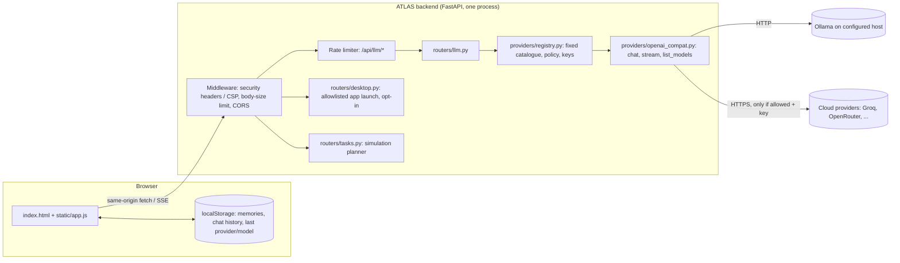

# Architecture (as built, v0.2.0)

ATLAS OS is currently one Python process that serves a static web UI and a JSON/SSE API. It is local-first: by default it talks only to Ollama on the same machine.

## Components

| Component | Responsibility | Notes |
|---|---|---|
| `app/main.py` | App factory, middleware, error handlers, `/health`, `/api/system/status`, static files | `create_app()` reads settings once for docs exposure |
| `app/config.py` | Typed settings from env | Read per call so tests and operators can change env |
| `app/security.py` | Headers/CSP, body limit, rate limiter | Rate limiter is in-memory, so it is only correct for one process |
| `app/providers/base.py` | `ChatMessage`, `Capabilities`, `ProviderSpec`, `ProviderError` | The provider-independent contract |
| `app/providers/openai_compat.py` | One adapter for every OpenAI-compatible API | Ollama uses its `/v1` compatibility endpoint for chat and `/api/tags` for discovery |
| `app/providers/registry.py` | Catalogue, policy checks, server keys, Ollama probe | Clients pick an **ID**, never a URL |
| `app/routers/llm.py` | `/api/llm/providers`, `/ollama/status`, `/models`, `/chat`, `/chat/stream` | |
| `app/routers/desktop.py` | `/api/desktop/status`, `/launch` | Disabled unless `ATLAS_ENABLE_DESKTOP_AGENT=true` |
| `app/routers/tasks.py` | `/api/tasks/plan` | Returns fixed steps; labelled simulation |
| `frontend/` | UI, no build step | All JS is in `static/app.js`, so a strict `script-src 'self'` CSP works |

## Data flows

**Local chat (default).** The browser builds `messages`: a system note with the saved memories, then up to 12 recent turns, trimmed to under 46,000 characters. It POSTs them to `/api/llm/chat/stream`. The backend validates, rate-limits and resolves `ollama`, then streams from `ATLAS_OLLAMA_BASE_URL/v1/chat/completions` and re-emits `start`, `delta` and `done`/`error` SSE events.

**Cloud chat (opt-in).** The same flow, but the user must pick a cloud provider and tick the billing/data-routing notice. A key is supplied per request or by `ATLAS_<PROVIDER>_API_KEY`. Messages, memories and turns leave the machine.

**Cancel.** Stop calls `AbortController.abort()`. Starlette sees the disconnect and cancels the response generator. That exits the `httpx` stream context, which closes the provider connection. The e2e test checks this on the fake provider side.

## Trust and network boundaries

1. **Browser ↔ backend.** Same-origin only (CORS denies other origins). There is **no authentication**, so anyone who can reach the port can use it. Bind to `127.0.0.1` (the uvicorn default) unless authentication is added.
2. **Backend ↔ providers.** Outbound only, to the fixed URLs plus the operator-set Ollama URL. Redirects are not followed. Provider bodies are never forwarded to the browser.
3. **Backend ↔ OS.** Only `desktop.py`, only when enabled, and only allowlisted argv lists with `shell=False`.

## Failure handling

Provider failures become a `ProviderError(status, code, message)` with a safe message. Before streaming starts, they are returned as HTTP errors; after it starts, as an SSE `error` event. The UI shows errors in a red bubble and never stores them as model answers.

## Local vs cloud processing

| Data | Where it lives | Leaves the machine when |
|---|---|---|
| Memories, chat history | Browser localStorage | Sent with chat requests to the chosen provider |
| CSV files | Browser memory only | Never |
| API keys | Request body only, or server env | Sent to that provider only |
| Dictation audio | Browser speech service | Chrome/Edge send it to their vendor |

## Retention and deletion

The server stores nothing: there is no database. Clearing chat history or memories in the UI deletes them from localStorage. Data already sent to a cloud provider follows that provider's retention policy.

## Not yet designed in code

The local Windows agent process, persistent storage, the task engine, auth and pairing are planned in `DECISIONS.md`. The cloud backend must never run the desktop agent (spec §4).
